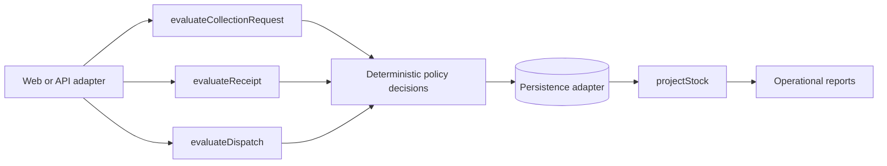

# Recycling Operations Domain

An executable domain model for collection, receipt, dispatch and stock rules in a circular-logistics operation.

## Problem

A recycling operation needs predictable decisions before it writes data: monthly client limits, partner specialization, minimum dispatch stock, role-based receipt authorization, unique collection codes and reproducible stock projections. Leaving those rules inside UI event handlers makes them hard to test and easy to bypass.

## Technical decision

The rules are pure TypeScript functions. They do not read the clock, browser storage or global state. A caller supplies the history and receives a structured decision with a stable machine code.



## Quick start

Requires Bun 1.x:

```powershell
./scripts/test.ps1
```

Or run the commands directly:

```bash
bun test
bun run src/demo.ts
```

To extract only public files into a new folder, rerun the privacy gate and create a clean local commit:

```powershell
./scripts/export-clean-repository.ps1 -Destination C:\work\recycling-operations-domain
```

## Invariants

1. A client places no more than ten collection orders in one month.
2. A client requests no more than 100 kg of the same material in one month.
3. Dispatch starts only when the deposit has at least 100 kg.
4. A partner receives only its configured material and never more than available stock.
5. Only a manager registers receipt, and each collection code is unique.
6. Projected stock is receipts minus dispatches, grouped by material.

## Repository layout

```text
src/domain.ts       pure business rules
src/demo.ts         executable scenario
test/domain.test.ts Bun unit tests
SOURCE_MAPPING.md   historical behavior to new boundary
PROVENANCE.md       authorship and privacy boundary
scripts/            test, publication gate and clean export
.github/workflows/  CI
```

## Provenance boundary

The code is a clean extraction written after auditing an Eduardo-authored Git worktree. The original monolithic UI, academic PDF, screenshots and personal-looking fixtures are intentionally absent. See [PROVENANCE.md](PROVENANCE.md).
